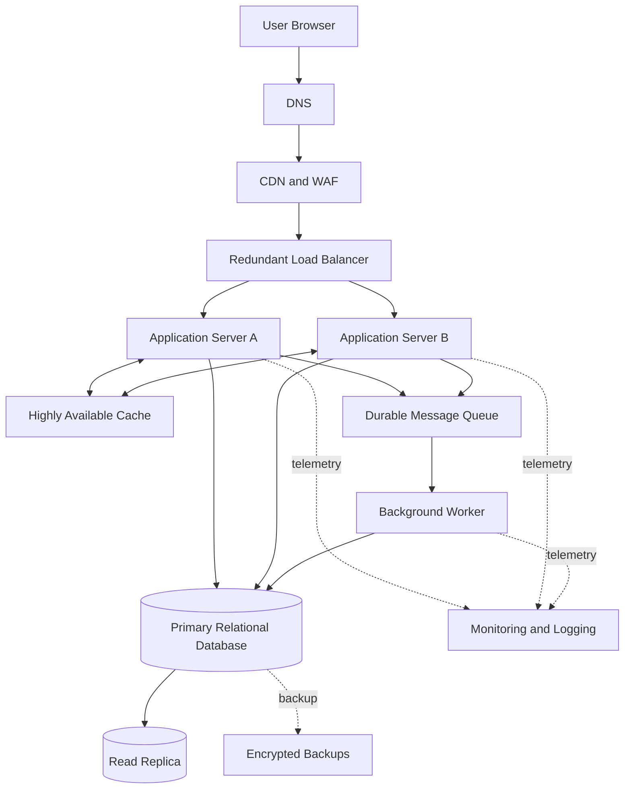

# QuickNotes System Architecture

## 1. Overview

QuickNotes is a web-based notes application that allows users to create, retrieve, update, and delete notes. The proposed architecture separates the browser interface, application services, caching, asynchronous processing, and persistent storage.

The architecture is designed to support growth toward one million registered users while maintaining security, reliability, and reasonable response times.

This is a proposed production architecture. The current browser prototype uses JSONPlaceholder and does not implement the complete infrastructure described here.

## 2. Functional requirements

1. Users can create an account and authenticate securely.
2. Users can list and retrieve their own notes.
3. Users can create, update, and delete notes.
4. Users can organise notes using tags.
5. Users receive useful loading, success, validation, and error messages.
6. Users cannot read or modify notes belonging to other users.

## 3. Non-functional requirements

- **Scalability:** Support growth in users and request volume by adding application instances.
- **Availability:** Avoid dependence on a single application server or database instance.
- **Performance:** Aim for a 95th-percentile response time below 300 ms for ordinary reads under the agreed workload, excluding unusually slow client networks.
- **Security:** Use HTTPS, authentication, authorization, input validation, and secure secret management.
- **Data integrity:** Use transactions, constraints, backups, and tested recovery procedures.
- **Maintainability:** Separate application logic, data storage, and background processing.
- **Observability:** Collect logs, metrics, traces, and alerts to detect and investigate failures.

These are proposed engineering targets, not measured results.

## 4. Architecture diagram

## 5. Role of each component

| Component | Responsibility and problem solved |
|---|---|
| Browser client | Provides the user interface for managing notes. |
| DNS | Resolves the application domain to the appropriate network endpoint. |
| CDN and WAF | Caches suitable static assets closer to users and filters common malicious web traffic. |
| Redundant load balancer | Distributes requests across healthy application servers and avoids depending on one application instance. |
| Application servers A and B | Execute API logic, validate requests, enforce authorization, and communicate with storage. Multiple instances support horizontal scaling. |
| Highly available cache | Stores frequently requested data temporarily to reduce database load and read latency. |
| Primary relational database | Stores authoritative user, note, and tag records and handles transactional writes. |
| Read replica | Serves suitable read queries to reduce load on the primary database. Replication lag must be considered. |
| Durable message queue | Buffers background tasks so that temporary processing delays do not block every user request. |
| Background worker | Processes queued tasks such as notifications, exports, or audit-event processing. |
| Monitoring and logging | Collects operational signals and supports alerts, troubleshooting, and capacity planning. |
| Encrypted backups | Protect data against accidental deletion, corruption, and certain infrastructure failures. |

The load balancer, cache, queue, and database services must themselves be deployed with appropriate redundancy and health monitoring. Merely drawing them in the diagram does not make them highly available.

## 6. Capacity estimates for one million users

These estimates are planning assumptions, not measured usage. Registered users do not all send requests simultaneously.

### 6.1 Assumptions

- Registered users: 1,000,000.
- Daily active users: 10% of registered users, or 100,000.
- Average API requests per daily active user: 20 per day.
- Peak traffic: 5 times the average request rate.
- Average note creation rate: 2 notes per active user per day.
- Average stored note content and metadata: 2 KB per note.
- Average active user creates notes on 300 days per year.

### 6.2 Read and write request estimates

Total API requests per day:

100,000 active users × 20 requests = 2,000,000 requests/day.

Average total request rate:

2,000,000 ÷ 86,400 ≈ 23 requests/second.

For planning, assume 80% reads and 20% writes.

| Measure | Estimate |
|---|---:|
| Average total API requests | 23 requests/second |
| Average read requests | 19 requests/second |
| Average write requests | 5 requests/second |
| Peak total requests at 5× average | 116 requests/second |
| Peak reads at 80% | 93 requests/second |
| Peak writes at 20% | 23 requests/second |

Values are rounded; the read and write figures may not sum exactly to the total because of rounding.

The model treats writes as a fraction of API requests. A production design should refine this estimate using actual request logs and separate creates, updates, and deletes.

### 6.3 Storage estimate

Assume each active user creates two notes per day on 300 days each year.

Annual notes created:

100,000 × 2 × 300 = 60,000,000 notes/year.

Annual logical note storage:

60,000,000 × 2 KB = 120,000,000 KB/year, approximately 120 GB/year using decimal units.

This is the estimated storage for new note records only. It excludes indexes, database overhead, backups, replication, attachments, audit logs, and other user data. Actual storage will depend on note size, retention, deletions, and user activity.

### 6.4 Scaling strategy

Begin with measured capacity tests and scale application servers horizontally as demand grows. Use caching for suitable repeated reads, connection pooling to control database connections, and read replicas for read-heavy workloads. Monitor database write capacity, cache hit rate, queue depth, latency, and error rates.

The estimates are starting assumptions for capacity planning, not proof that the architecture can already support one million users.

## 7. GET /notes request flow

1. The user opens the notes page and requests their notes.
2. DNS resolves the application domain.
3. The CDN and WAF handle applicable edge traffic and forward the API request.
4. The load balancer routes the request to a healthy application server.
5. The application server authenticates the user and validates the requested pagination parameters.
6. The server checks the cache if the query is cacheable and a safe cache key is available.
7. On a cache miss, the application retrieves the user's notes from the primary database or an appropriate read replica.
8. The server returns the notes as JSON with an appropriate HTTP status.
9. The client displays the notes and a suitable success or error message.

Cache keys must include the appropriate user and query context. Private notes must never be exposed through a shared cache entry. Read replicas may return slightly stale results because replication is not always instantaneous.

## 8. POST /notes request flow

1. The user submits a note through the browser.
2. The client checks required fields and sends a JSON POST request over HTTPS.
3. DNS, the CDN/WAF, and the load balancer route the request to a healthy application server.
4. The server authenticates the user, validates the title and body, and derives the user's identity from the authenticated session or token.
5. The application writes the note to the primary database inside an appropriate transaction.
6. The database commits the transaction and returns the new note ID.
7. The application returns `201 Created` with the created note representation.
8. The browser adds the returned note to the interface and displays a success message.
9. If background work is required, such as sending a notification, the application publishes a message to the durable queue. The worker processes it independently.

The queue should not be used to delay the core database write unless the API is explicitly designed for asynchronous note creation. If a request must publish a message reliably alongside a database transaction, an outbox pattern can reduce the risk of a committed note without its associated event.

## 9. Architecture trade-offs

### Trade-off 1: Cache performance versus consistency

Caching reduces database load and can improve response times. However, cached notes may be stale after updates or deletion.

**Mitigation:** Use appropriate expiration times and invalidate or update cache entries after successful writes. Apply user-specific cache keys and avoid caching sensitive data unless access controls are correct.

### Trade-off 2: Read replicas versus consistency

Read replicas distribute read traffic and reduce pressure on the primary database. However, asynchronous replication can cause a user to see an older version immediately after a write.

**Mitigation:** Route consistency-sensitive reads to the primary database or use a defined read-after-write strategy.

### Trade-off 3: Multiple application servers versus operational complexity

Horizontal scaling improves capacity and resilience but introduces more infrastructure to monitor and maintain.

**Mitigation:** Use health checks, automated deployment, centralised logging, consistent configuration, and managed services where appropriate.

### Trade-off 4: Synchronous work versus asynchronous processing

Queues let background tasks run independently and absorb temporary traffic spikes. They also introduce eventual consistency, retries, and possible duplicate message delivery.

**Mitigation:** Make workers idempotent, configure retries and dead-letter handling, and monitor queue depth and processing failures.

## 10. Avoiding single points of failure

- Deploy application servers across separate failure domains and configure health checks and automatic replacement.
- Use redundant load-balancing infrastructure and DNS health management where supported.
- Deploy cache and message-queue services in highly available configurations.
- Configure database replication, automated failover, point-in-time recovery where available, and tested backups.
- Store backups separately from the primary database environment and periodically test restoration.
- Monitor service health and alert on rising latency, error rates, replication lag, and queue backlogs.
- Document recovery objectives and test failure scenarios before production deployment.

A read replica alone is not a complete disaster-recovery strategy. The system also needs tested failover, recovery procedures, and independent backups.
